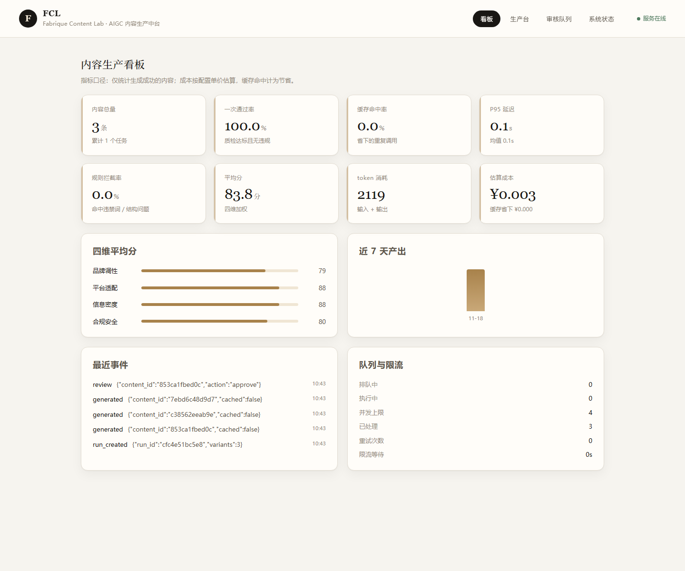

# FCL · 设计师品牌 AIGC 内容生产中台

> 面向设计师女装品牌的小红书内容生产系统：**批量生成 → 硬规则质检 → 四维打分 → 人工审核 → 成本看板**。
>
> 个人项目 · 借助 AI 编程工具（Codex / DSH）实现。需求拆解、技术选型、提示词与评测口径由本人设计，并逐文件读懂核心代码。
>
> **仓库地址**：<https://github.com/scenery-jinhua/fcl-content-lab>



---

## 这个项目解决什么问题

设计师品牌 SKU 多、上新快，一个商品要在小红书上发多篇不同角度的笔记。纯人工写产能不够，直接把商品丢给大模型又会出四个问题：

| 问题 | 后果 | 本项目的做法 |
|---|---|---|
| 调性跑偏 | 文案像详情页，品牌形象受损 | RAG 检索品牌规范 + 四维打分，低分退回重写 |
| 违反广告法 / 平台规则 | 笔记限流、账号降权 | 违禁词与导流话术的硬规则拦截，命中即扣分 |
| 成本和延迟失控 | token 费用高、接口超时或 429 | TTL+LRU 缓存、令牌桶限流、并发上限、指数退避重试 |
| 生成完没人质检 | 运营逐条看，反而更慢 | 自动打分排序 + 人工终审队列 |

---

## 3 分钟跑起来（不需要任何 API Key）

`ash
git clone https://github.com/scenery-jinhua/fcl-content-lab.git
cd fcl-content-lab
`

### Windows（最省事）

1. 安装 Python 3.10+（安装时勾选 `Add Python to PATH`）
2. 双击项目根目录的 **`start.bat`**
3. 浏览器打开 <http://127.0.0.1:8000>

`start.bat` 会自动完成：建虚拟环境 → 装依赖 → 造商品数据 → 启动服务。

### 手动执行（Windows / macOS / Linux 通用）

```bash
python -m venv .venv
# Windows:
.venv\Scripts\activate
# macOS / Linux:
source .venv/bin/activate

pip install -r requirements.txt
python scripts/seed.py
python -m uvicorn app.main:app --port 8000
```

打开 <http://127.0.0.1:8000>。接口文档在 <http://127.0.0.1:8000/docs>。

**默认使用 mock 模型**：离线、免费、可复现，用来演示完整链路（含超时重试、JSON 修复、违禁词拦截、缓存命中）。第一次运行不需要配置任何东西。

---

## 接入真实大模型（可选）

任何 OpenAI 兼容接口都可以（DeepSeek / 通义 / 硅基流动 / 本地 Ollama）：

```bash
# Windows PowerShell
$env:FCL_PROVIDER="openai_compat"
$env:FCL_LLM_BASE_URL="https://api.deepseek.com/v1"
$env:FCL_LLM_API_KEY="sk-xxxx"
$env:FCL_LLM_MODEL="deepseek-chat"
python -m uvicorn app.main:app --port 8000
```

更多可调参数见 `.env.example`（并发数、限流、缓存时长、通过阈值、token 单价等）。

---

## 怎么用

| 页签 | 干什么 |
|---|---|
| **生产台** | 选商品、选内容角度（通勤/约会/松弛感/旅行/面试）、设置变体数，批量生成。页面不阻塞，进度实时回写 |
| **审核队列** | 按状态查看全部内容：待审、需重写、已通过、已驳回；逐条通过或驳回，一键复制文案 |
| **看板** | 产能、质量、效率、成本四组指标：内容总量、一次通过率、缓存命中率、P95 延迟、规则拦截率、平均分、token 消耗、估算成本 |
| **系统状态** | 模型供应商、是否真计费、提示词版本、缓存后端与命中率、RAG 索引分块数与向量化进度、质检阈值 |

---

## 项目结构

```
app/
  main.py              FastAPI 入口：路由装配 + 生命周期 + 静态页挂载
  config.py            全部配置走环境变量，有默认值，离线可跑
  db.py                SQLAlchemy engine / session / 建表
  models.py            5 张表：products / runs / contents / eval_records / events
  schemas.py           Pydantic 请求/响应模型（接口契约）
  api/                 products / runs / dashboard 三组接口
  providers/           大模型抽象层：mock（离线） / openai_compat（真实）
  services/
    pipeline.py        生成编排：缓存 → RAG → Writer → Critic → Judge → 重写 → 落库
    queue.py           asyncio 队列 + 并发上限 + 超时重试 + 幂等 + 重启补偿
    quality.py         违禁词规则引擎 + LLM-as-Judge 四维打分
    rag.py             品牌规范分块与检索（向量优先，关键词兜底）
    cache.py           TTL + LRU + 单飞（防击穿）+ 可选 Redis
    ratelimit.py       令牌桶限流
    metrics.py         看板指标聚合
  static/              后台单页：看板 / 生产台 / 审核队列 / 系统状态
data/
  brand_guidelines.md  品牌内容规范（RAG 语料，可直接编辑）
scripts/
  seed.py              商品种子数据
  demo_batch.py        批量压测，输出真实指标到 data/metrics.json
  smoke_test.py        端到端冒烟测试
  config_audit.py      配置与数据体检（验证规则引擎、核对看板数字）
tests/                 16 条测试：规则 / 限流 / 缓存 / 检索 / JSON 修复 / 接口契约
```

---

## 实测指标

运行 `python scripts/demo_batch.py --count 100 --passes 2`（结果写入 `data/metrics.json`）：

| 指标 | 第一轮（冷启动 100 条） | 第二轮（命中缓存） |
|---|---|---|
| 单条 P50 / P95 延迟 | 138ms / 504ms | ~0ms / ~0ms |
| 一次通过率 | 73.0% | 73.0% |
| 规则拦截率 | 26.0% | 26.0% |
| 平均分 | 84.1 | 84.1 |
| token 消耗 | 86,946 | **0** |
| 估算成本 | ¥0.1172 | **¥0** |

> ⚠️ 这些是 **mock 模型下的工程指标**，反映流程本身的表现，不是真实大模型的业务效果。接入真实 API 后需要重跑。

---

## 设计取舍

- **为什么用队列**：HTTP 请求等不了 100 条生成；并发不限会打挂上游；失败要能重试和断点续跑。
- **为什么规则 + 模型两层质检**：广告法红线必须确定性拦截，调性判断交给模型，最终由人拍板。合规维度取「规则分和模型分的最小值」——宁可误杀，不可漏放。
- **为什么缓存 key 带提示词版本**：提示词一改，旧缓存必须失效，否则会拿旧结果骗人。
- **为什么能降级**：Redis 不可用退化为内存、embedding 不可用退化为关键词、真实模型不可用退化为 mock——演示环境永远跑得起来。
- **为什么缓存存的是「正文 + 质检结论」**：只存正文的话，命中缓存后还得再调一次 Judge，缓存只能省一半钱。

**已知边界**：单机异步队列（进程重启依赖数据库补偿）、无鉴权、无多租户、未接真实向量库。上线前需换 Celery + Redis + MySQL + 鉴权 + 真实向量检索。

---

## 测试

```bash
# 全部测试（16 条）
python -m pytest -q

# 端到端冒烟：需要先启动服务
python scripts/smoke_test.py

# 配置与数据体检：验证规则引擎确实能拦截，并核对看板数字
python scripts/config_audit.py
```

> 如果 8000 端口被占用：`FCL_BASE=http://127.0.0.1:8010` 后再跑冒烟测试。

---

## 常见问题

| 现象 | 原因与解法 |
|---|---|
| 双击 `start.bat` 一闪而过 | 没装 Python 或没加到 PATH。装 Python 3.10+ 时勾选 `Add Python to PATH` |
| `run.ps1` 报「字符串缺少终止符」 | 用系统自带的 Windows PowerShell 5.1 打开过旧版脚本。双击 `start.bat` 即可，或 `powershell -ExecutionPolicy Bypass -File .\run.ps1` |
| `error while attempting to bind on address` | 8000 端口被占用。换端口：`python -m uvicorn app.main:app --port 8001` |
| 浏览器打开是空白 | 服务刚启动还在建 RAG 索引，等 2 秒刷新；或看控制台是否有红色报错 |
| 页面显示「服务异常」 | 后端没起来。查看启动窗口最后 10 行报错 |

---

## 许可

MIT License，详见 [LICENSE](LICENSE)。仅用于个人求职与学习展示。

仓库：<https://github.com/scenery-jinhua/fcl-content-lab>
